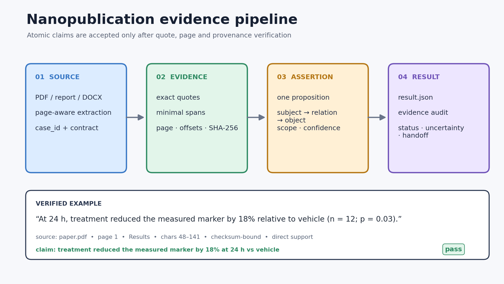

# Nanopublication Extractor

Turn supplied research material into a validated, machine-readable set of
nanopublication records. The central invariant is: **every material assertion
must be supported by a short, verbatim source span whose location can be
checked.**

## Run contract

Read the case instructions first. The usual runtime inputs are
`/input/case.json` and `/input/task.md`; resolve paths returned by
`case.json` relative to the case file, then the current directory. Write all
work under `/app/work` and actual deliverables under `/app/output`. If those
directories do not exist in a non-platform test, use the paths supplied by the
caller.

Requirements: Python 3.10+ and the bundled `scripts/nanopub.py`. PDF extraction
tries PyMuPDF, pypdf/PyPDF2, then Poppler `pdftotext`; at least one backend must
exist. The script otherwise uses only the standard library and makes no network
requests. Check the installed version with `python scripts/nanopub.py --version`.

Preserve every field and value requested by `output_contract`. Never replace a
contract field with a summarised alias. The final `result.json` must include the
original `case_id`, the requested task output, and the evidence/provenance
structure below.

Do not invent paper metadata, author identities, percentages, effect
directions, study sizes, identifiers, or source page numbers. An unavailable
fact is `null` and an unsupported claim is omitted or marked as uncertain.

## Workflow

1. Inspect the case:

   ```bash
   python scripts/nanopub.py prepare \
     --case /input/case.json --input /input --out /app/output
   ```

   This writes `work/source_index.json`, `work/evidence.jsonl`,
   `work/candidates.jsonl`, and `work/inventory.json`. Read the task and
   `inventory.json` before interpreting the science.

2. Answer any direct questions in the requested language, with page-level
   evidence. Keep this answer distinguishable from the atomised assertions.

3. Search for the smallest supporting passage rather than the whole paragraph:

   ```bash
   python scripts/nanopub.py search \
     --index /app/output/work/source_index.json \
     --query "your topic or number" --limit 8
   ```

4. Use `work/candidates.jsonl` only as a recall aid. Read each candidate in
   context from its page or source span. Scientific meaning, not a trigger word,
   determines whether it is a claim.

5. Build a draft JSON with one independently checkable proposition per
   assertion. Split conjunctions when the parts can be true independently.
   Preserve population, material, conditions, comparator, direction, magnitude,
   uncertainty, and temporal scope. Do not strengthen association into
   causation. Copy evidence quotes verbatim from `evidence.jsonl`.

6. Finalise and validate:

   ```bash
   python scripts/nanopub.py finalize \
     --case /input/case.json --draft /app/work/claims.json \
     --index /app/output/work/source_index.json --out /app/output
   python scripts/nanopub.py validate --result /app/output/result.json
   ```

7. Inspect `result.json`. Fix semantic issues in the draft and rerun
   `finalize`; do not hand-edit derived page offsets. If extraction succeeded
   only partially, set `status` to `partial` and record the unreadable or
   undecidable material in `uncertainties`. Keep substantive revisions in the
   draft's `change_log`; the finaliser adds the mechanical verification record.

## Assertion standard

Each assertion needs:

- one proposition with subject, relation, object/value, and applicable scope;
- a normalised `relation_type` from the controlled vocabulary in the field
  dictionary (the finaliser infers it when omitted);
- `assertion.text` faithful to the source and no broader than its evidence;
- at least one exact evidence quote with source, page, section and offsets;
- direct, indirect, or contextual evidence type;
- explicit support relation: `supports`, `refutes`, `qualifies`, or
  `contextualizes`;
- confidence with a reason, not a bare unexplained score;
- provenance and quality flags.

The finaliser derives page/paragraph/character offsets and stable identifiers.
It rejects a quote that does not occur exactly (after whitespace
normalisation) in the indexed source. If a contract requires a field not
covered here, place it in `task_output` and at the top level under its exact
contract name.

Read [references/extraction-rules.md](references/extraction-rules.md) when
handling causal language, numbers, comparison, figures/tables, multi-claim
sentences, or contradictions. Read
[references/field-dictionary.md](references/field-dictionary.md) when mapping or
extending output fields, and
[references/output_schema.json](references/output_schema.json) before writing a
draft that must follow the extended contract. The canonical sample/high-level
format is in [references/examples.md](references/examples.md); those are
explanatory examples, never case answers.
[references/self-check-cases.md](references/self-check-cases.md) is a reusable
smoke-test question set. Run `python scripts/selftest.py` to verify both a
successful exact-evidence path and rejection of a corrupted quote.

## Failure boundaries

- Empty text layer: inspect rendered pages and OCR only the relevant pages;
  record OCR provenance.
- Table/figure evidence: bind to the caption plus the specific row/panel, and
  say which panel carries the support.
- Conflicting passages: emit competing assertions only if each has direct
  evidence; otherwise one assertion plus a contradiction uncertainty.
- Missing source or inaccessible page: do not infer its contents. Use
  `status: partial` or `unable` and give a concrete handoff.
- No task-requested data in a readable source: `unable` is valid. Do not fill
  the gap with general knowledge.

Finish only after `validate` passes or the remaining failure is explicitly
represented in the result.


